<h1 align="center">Hi, I'm Swaraj 👋</h1>

  Junior Fullstack Developer · M.Sc. Management and Digital Technology @ TUM

  
  

<!-- Two stacks, one glance. Edit the icon ids after "i=" — full list: https://skillicons.dev -->
<table align="center">
  <tr>
    <th>💼 At work</th>
    <th>🎓 At university</th>
  </tr>
  <tr>
    <td align="center">
      
    </td>
    <td align="center">
      
    </td>
  </tr>
</table>

<!-- Cards are generated by .github/workflows/profile-cards.yml and switch with the viewer's light/dark theme -->

  <picture>
    <source media="(prefers-color-scheme: dark)" srcset="./profile/top-langs-dark.svg" />
    
  </picture>
  &nbsp;
  <picture>
    <source media="(prefers-color-scheme: dark)" srcset="./profile/stats-dark.svg" />
    
  </picture>

